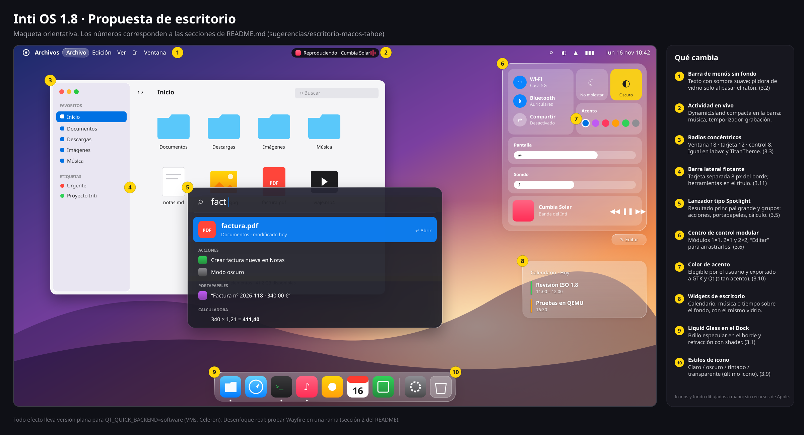

# Sugerencias: un escritorio tipo macOS Tahoe para Inti OS

Fecha: 2026-11-15. Estas sugerencias parten de lo que ya hay en el repo y no de
cero: labwc como compositor, `titan-shell` (Qt Quick + layer-shell) con TopBar,
Dock, Launcher, ControlCenter, NotificationCenter, DynamicIsland y
WorkspacesView, `titan-desktop` para el fondo y `titan-theme` (TitanTheme,
GlassPanel, TitanWindow) para las apps.

Maqueta visual: `maqueta-escritorio.png` (fuente editable: `maqueta-escritorio.svg`).

**Regla legal:** se imita el *lenguaje de diseño*, no los recursos de Apple. No
uses iconos, fondos, sonidos ni la fuente SF Pro de Apple (su licencia solo
permite usarla en plataformas Apple). Las alternativas libres son **Inter**
(UI) y **JetBrains Mono** (terminal), con iconos propios o de un paquete libre
como Papirus o WhiteSur recoloreado.

---

## 1. Qué define a Tahoe (macOS 26)

| Rasgo | Qué es | Qué hay hoy en Inti OS |
|---|---|---|
| **Liquid Glass** | Material translúcido que *refracta* lo que hay detrás (lente en los bordes), con brillo especular que sigue la luz y se adapta a claro/oscuro | `GlassPanel.qml`: falso desenfoque (fondo de pantalla reducido a 48×27 y ampliado). Solo refleja el fondo, no las ventanas |
| **Barra de menús transparente** | Sin fondo; el texto flota sobre el wallpaper | `TopBar.qml` con panel de vidrio |
| **Dock de vidrio** | Más fino, sin estante opaco, iconos con sombra suave | `Dock.qml` ya existe |
| **Iconos claro / oscuro / tintado / transparente** | El usuario elige el estilo de todos los iconos | Iconos fijos |
| **Esquinas más redondeadas** | Ventanas con radio mayor (unos 16–26 px) y concéntrico con los controles | labwc `cornerRadius 10`, `windowRadius 14` en TitanTheme |
| **Centro de control personalizable** | Módulos que se añaden, quitan y cambian de tamaño | `ControlCenter.qml` (1188 líneas) con módulos fijos |
| **Spotlight con acciones** | Buscar apps, ficheros, *acciones* ("crear nota") y **historial del portapapeles** | `Launcher.qml` (busca apps) |
| **Actividades en vivo en la barra** | Música, temporizador, llamadas en la barra de menús | `DynamicIsland.qml` ya lo hace parecido |
| **Barras laterales flotantes** | La sidebar es una tarjeta de vidrio separada del borde de la ventana | `TitanWindow.qml` con sidebar pegada |

---

## 2. El problema de fondo: el desenfoque real

Ahora todo el "vidrio" de Inti OS solo deja ver el **fondo de pantalla**. Si
pasas un panel por encima de una ventana, el panel sigue enseñando el wallpaper
en vez de la ventana, y eso es lo que más delata que no es macOS. **labwc no
tiene desenfoque en vivo** y no hay un protocolo de Wayland que permita a
`titan-shell` leer lo que hay debajo.

Opciones, de menos a más trabajo:

1. **Seguir con labwc y el falso desenfoque** (lo actual), pero mejorado (ver
   sección 3.1). No cuesta nada y funciona en hardware débil y en VMs con
   renderizado por software. *Recomendado como base.*
2. **Pasar a un compositor con blur:**
   - **Wayfire**: es stacking como labwc, tiene plugin de blur y animaciones y
     sigue siendo ligero. Es el más parecido en espíritu y el que menos cambia:
     `titan-shell` funciona igual porque usa layer-shell y foreign-toplevel.
   - **Hyprland**: blur y animaciones excelentes, pero es *tiling* por defecto
     y su API cambia a menudo.
   - **KWin (Plasma)**: ya está como sesión opcional (`TITAN_DESKTOP=plasma`).
     Tiene blur, pero mezclar el shell de Plasma con `titan-shell` es frágil.
3. **labwc con SceneFX**: es la librería de efectos de SwayFX (blur, sombras y
   esquinas). Hoy labwc no la usa; habría que mantener un fork, así que no lo
   recomiendo.

**Recomendación:** mantener labwc y preparar `titan-shell` para que funcione
con *cualquier* compositor wlroots. Después, probar Wayfire en una rama como
"modo vidrio real" que se active solo si hay GPU, y usar el falso desenfoque
como respaldo (la lógica de detección de GPU de `15-titan-grafico.sh` ya existe).

---

## 3. Sugerencias concretas, por prioridad

### Prioridad 1: lo que más se nota y menos cuesta

**3.1 Liquid Glass en `GlassPanel.qml` con un shader.**
El falso desenfoque actual se queda, y encima se añade un `ShaderEffect` con:
- **Refracción en los bordes:** en una franja de unos 12 px junto al borde, se
  desplaza el muestreo del fondo hacia fuera según la distancia al borde (como
  una lente). Es lo que distingue a Liquid Glass del "frosted glass" anterior.
- **Brillo especular:** un degradado fino en el borde superior izquierdo con
  más intensidad en las esquinas, en vez del borde blanco uniforme actual.
- **Ajuste de contraste:** se mide el brillo medio del trozo de fondo (ya está
  reducido a 48×27, así que es barato) y el tinte y el color del texto pasan a
  claro u oscuro según ese brillo. Así la barra transparente se lee igual sobre
  un fondo claro que sobre uno oscuro.
- El shader debe compilarse con `qsb` para los backends RHI y tener un camino
  sin shader para `QT_QUICK_BACKEND=software` (VMs y modo compatibilidad).

**3.2 Barra de menús sin fondo.**
`TopBar.qml` deja de dibujar el panel: texto e iconos con una sombra muy suave
y el color decidido por el ajuste de contraste del punto anterior. Las
"píldoras" de vidrio solo aparecen al pasar el ratón o al abrir un menú.

**3.3 Radios concéntricos.**
Una sola escala en `TitanTheme.qml`: ventana 18, tarjeta 12, control 8, más
un `margin` que cumpla `radio_interior = radio_exterior − margen`. Y labwc
`cornerRadius` igual al de la ventana. Ahora mismo hay 10, 14 y 18 mezclados.

**3.4 Tipografía.**
Inter con `font.features: {"cv11": 1, "ss01": 1}` (dígitos y "a" más parecidos
a SF), con un peso de 500 para títulos y 400 para el cuerpo. Una escala fija
(11, 13, 15, 20, 26) definida en TitanTheme y no por app.

### Prioridad 2: comportamiento

**3.5 Spotlight de verdad (`Launcher.qml`).**
- Que el resultado principal se vea arriba y grande, con el resto agrupado
  (Apps / Ficheros / Ajustes / Acciones).
- **Acciones:** "Apagar", "Modo oscuro", "Nueva nota", "Captura de pantalla"…
  son entradas de un JSON que ejecutan órdenes.
- **Historial del portapapeles** con `wl-clipboard` (`wl-paste --watch`) y un
  límite de entradas, guardado solo en memoria por privacidad.
- Calculadora y conversión de unidades en línea (ya existe `titan-calc`).

**3.6 Centro de control modular.**
Separar `ControlCenter.qml` (1188 líneas) en un módulo por fichero
(`cc/Wifi.qml`, `cc/Volumen.qml`…) y una lista en
`~/.config/titan/centro-control.json` con el orden y el tamaño (1×1, 2×1, 2×2).
Editar = arrastrar.

**3.7 Mission Control y Stage Manager.**
`WorkspacesView.qml` ya muestra las ventanas por escritorio. Lo siguiente es
añadir miniaturas reales con `ext-image-copy-capture-v1` (lo soportan las
versiones recientes de wlroots/labwc) y, si no está disponible, quedarse con los
iconos como ahora.

**3.8 Animaciones con muelles.**
Usar `SpringAnimation` (spring 3–4, damping 0.3–0.4) en vez de duraciones fijas
para abrir paneles, el Launcher y el Dock, y respetar un ajuste "Reducir
movimiento" en titan-settings.

### Prioridad 3: identidad y apps

**3.9 Estilos de icono:** claro / oscuro / tintado (monocromo con el color de
acento) / transparente. Con iconos SVG propios se hace recoloreando en QML con
`MultiEffect.colorization`, sin necesidad de cuatro juegos de iconos.

**3.10 Color de acento** elegido en titan-settings y expuesto por
`ThemeManager` (ahora `accent` está fijo a `#0071e3`). Lo usan todas las apps
Titan y se exporta a GTK (`gsettings accent-color`) y a Qt (paleta).

**3.11 Sidebar flotante en `TitanWindow.qml`:** la barra lateral pasa a ser
una tarjeta de vidrio con un margen de 8 px y su propio radio, y la barra de
herramientas se integra en el título.

**3.12 Coherencia con apps externas:** un tema GTK4/libadwaita y un estilo
Kvantum o qt6ct con la misma paleta, para que Firefox y las apps GTK no
desentonen. Además, botones de ventana tipo "semáforo" en labwc (ya existe
`TrafficLights.qml` para las apps Titan; falta el tema de labwc con los mismos
colores y tamaños).

**3.13 Pantalla de bloqueo y arranque:** reloj grande con fuente fina sobre el
wallpaper con Liquid Glass, y la misma imagen en el splash, en GRUB y en el
bloqueo para que el arranque sea continuo.

---

## 4. Rendimiento (no perder lo que ya funciona)

- El hardware objetivo incluye Celeron y VMs sin 3D (`15-titan-grafico.sh` ya
  lo detecta). Todo efecto nuevo necesita su **versión plana** cuando
  `QT_QUICK_BACKEND=software`. Lo más sencillo es una propiedad
  `TitanTheme.efectos` (true/false) que miren todos los componentes.
- Los shaders se aplican solo a capas estáticas (`layer.enabled` y que no se
  redibujen salvo al cambiar el fondo), como ya hace GlassPanel.
- Hay que medir: `QSG_RENDER_TIMING=1` antes y después de cada cambio.

## 5. Orden propuesto

1. TitanTheme: radios, tipografía y acento (3.3, 3.4, 3.10). Es la base de
   todo lo demás.
2. GlassPanel con shader y ajuste de contraste (3.1), y TopBar transparente
   (3.2).
3. Launcher/Spotlight (3.5).
4. ControlCenter modular (3.6).
5. Prueba de Wayfire en una rama (sección 2).
6. El resto.
